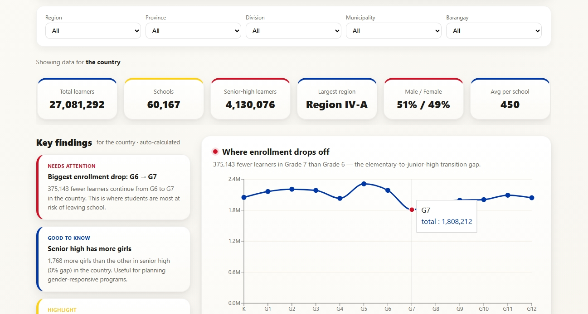

# Aralite 📊

**In browser SQL analytics for Philippine school enrollment. No server, no database bill.**

Aralite turns the Department of Education's raw enrollment file (60,167 schools, 27M learners) into a clean, filterable dashboard. It runs a real SQL database *inside the browser*, so anyone can explore the data. You can drill from region down to a single barangay, or ask questions in plain English.

It also makes one argument, and the page is arranged to support it.

> **The average senior high school runs 2.52 of the 8 tracks and strands on offer.** A learner in BARMM is roughly **6× more likely** than one in Region IV-A to attend a school running only one, so senior high enrollment reflects what schools offer as much as what learners want.

The full working is in [`analysis/strand-availability/`](analysis/strand-availability/). It has the notebook, a reproducible script, and a writeup that states what the data cannot prove.

[](https://github.com/angelinetipa/aralite/actions/workflows/ci.yml)

**Live site.** [aralite.vercel.app](https://aralite.vercel.app)



## What it is

This started as a university case study in a Big Data course. The scenario was that DepEd's Learner Information System collects enrollment data, but there is no dashboard on top of it, so other offices have to request figures by hand, one at a time. The exercise was to design something planners could actually use.

I rebuilt it from scratch afterwards as an independent project, because the class version ran on a laptop and I wanted to learn what it takes to ship something a stranger can open.

If you want to know how any piece works, [`docs/LEARNING.md`](docs/LEARNING.md) explains every tool and decision in plain language. [`docs/WALKTHROUGH.md`](docs/WALKTHROUGH.md) explains every file and the questions an interviewer may ask.

## How to try it

Open the [live link](https://aralite.vercel.app). No login, no setup. The cleaned data ships with the app.

The top of the page is the same for everyone. It shows the finding, the two charts behind it, and the regions to act on first. Scroll to **Explore your area** and pick a region. The stat cards compare it with the country, and the charts below respond. Narrow to a province or a barangay to fill the school list. Click the small **i** button on a chart card to read its key finding. Then scroll to **Ask the data** and type a question in plain English. That one needs your own Groq or Gemini key, and the generated SQL is shown before it runs.

The dashboard takes a moment on first load while the SQL engine boots in your browser. The banner renders first on purpose, so there is something to read while it starts.

To try your own file, open the **Admin** page from the top right.

## Features

- **The finding first.** The page opens with the claim in one sentence and its caveat attached, on a dark card. This part is always national, so nothing at the top moves when you filter.
- **Evidence, side by side.** Two charts support the finding directly. One shows strands per school and the other shows the share of learners with no alternative. Every bar is gray except the priority regions, which are red.
- **A recommendation with a rule.** The four regions to widen first are calculated from the same data as the charts, not typed in. The panel also says what the data cannot decide.
- **Explore your area.** Five cascading filters (Region, Province, Division, Municipality, Barangay) in a two column bar. Four compact stat tiles compare the chosen area with the country.
- **Key findings on demand.** Each chart card has a small **i** button. It opens a short note and closes on a click outside or the Escape key, so the cards stay short.
- **The rest of the data.** Six more charts sit below the filter. Most of them respond to it. The region treemap stays national and lets you click a tile to set the filter.
- **A school list that never leaves a gap.** Until you pick a region, the list slot shows a short hint. After that it lists the largest schools and scrolls inside a fixed height, so the chart beside it keeps its size.
- **Ask the data.** Type a question in plain English. Your own AI key (Groq or Gemini) writes the SQL, which runs read only in the browser. The SQL is shown for trust.
- **Admin page.** A separate `/admin` area with a status card, a remove action with a confirm step, and an upload card beside a cleaning report.
- **Clean any dataset.** Upload a CSV or Excel file. It is cleaned in your browser (encoding, junk characters, invalid values, name and address standardization) and downloadable. Nothing leaves your computer.
- **Limits stated in the product.** An "About this data" card names the source, the grain, and what the data cannot answer, so no one draws a conclusion it does not support.

## Design rules

The charts follow one set of rules, so a color always means the same thing.

| Color | Meaning |
|---|---|
| Gray | Default. Every bar starts here. |
| Blue | The one thing to look at in a chart, such as the largest bar. |
| Red | Worse than the national figure, or a priority region. Nothing else is red. |

Other rules that apply everywhere.

- Every chart title states what the chart shows, and the caveat sits in the subtitle.
- Axes stay, start at zero, and have a title. Gridlines are removed.
- Important bars carry their value as a direct label, so no legend is needed.
- Gender uses two shades of the brand blue. It is a comparison between two groups and not a warning, so red is never used for it.
- Dark cards are used for two blocks only, the finding and the ask box, placed on opposite corners so the page stays balanced.
- Every button comes from one component, so every action looks the same.

The color roles live in `src/constants/theme.ts`, so changing them there changes every chart.

## Layout

The page uses one 12 column grid, called the bento grid. It is defined in `src/index.css`.

- A row is a `div` with the class `aralite-bento`.
- Each block sits in a wrapper with a span class, such as `bento-4` or `bento-7`. The spans in a row add up to 12.
- The wrapper also carries `bento-fill`, so the card inside fills its cell. Blocks in one row stretch to the same height.
- The wrapper always renders, so the grid keeps its shape while data loads.

Row shapes on the dashboard are 4 + 4 + 4, then 12, then 5 + 7 for the explore row, then 7 + 5, 4 + 5 + 3, 5 + 7, and a last row of 7 + 5 for the limits card and the ask box.

On screens up to 1100px wide, blocks go two per row. On screens up to 700px wide, everything stacks in one column.

## Data and method

**Source.** DepEd Learner Information System, school level enrollment, SY 2023 to 2024 (as of 31 January 2024). Public data, downloaded as an Excel file.

**Shape.** 60,167 rows, one per school, with 14 descriptive columns and 58 enrollment columns. Reshaped into roughly 3.5 million rows, one per school × grade × gender.

**The governing rule was zero data loss.** The cleaning script never deletes a row or a column. It repairs values in place and adds standardized copies alongside the originals, so every published number can be traced back to the source file.

What `pipeline/clean.py` does.

| Step | What and why |
|---|---|
| Find the real header | The file opens with four rows of title text, so the actual column names sit on row 5. |
| Repair mojibake | `Ñ` saved as UTF-8 but read as Latin-1 arrives as `Ñ`. The bad decode is reversed, not stripped, because deleting would corrupt school names. |
| Strip leading junk | Stray `-`, `#`, `*`, `.` and quote marks from data entry break sorting and search. |
| Squeeze whitespace | Without this, `Bacarra  I` and `Bacarra I` group as two different divisions. |
| Standardize casing | Geographic columns arrive in all caps. Filters and joins are case sensitive, so inconsistent casing splits real groups. School names keep their official casing. |
| Label invalid values | Placeholder entries like `N/A` and `NONE` are marked rather than silently dropped. |
| Add clean copies | Standardized school name and street address are added as new columns beside the originals. |
| **Validate, don't repair** | School IDs are asserted unique, enrollment values are parsed with errors raised rather than coerced, and negatives are asserted away. The script **stops** on a structural problem instead of quietly producing a wrong number. |
| Derive total enrollment | The raw file has no total column, so the 58 grade columns are summed into one. |
| Reshape wide to long | 58 enrollment columns become rows, each parsed into grade, strand, and gender. |
| Export with proof | Parquet files, plus `quality_report.md` recording every repair count, rows in versus out, and the total enrollment sum. |

The quality report is the point of the whole script. Anyone can claim they cleaned data. The report shows exactly what changed and proves nothing was lost.

## Tech stack

| Part | What I use |
|---|---|
| Frontend | React, TypeScript, Vite, React Router |
| Charts | Recharts |
| Data engine | DuckDB-WASM (real SQL in the browser) |
| Storage format | Parquet |
| Cleaning pipeline | Python, pandas |
| Excel reading | xlsx, loaded only when a file is uploaded |
| AI (optional) | Groq or Gemini, bring your own key |
| Testing and CI | Vitest, GitHub Actions |
| Hosting | Vercel |

## How it works

### Two lanes

One runs once on my computer. The other runs every time someone opens the site.

```
CLEANING LANE (once, offline)
  raw.xlsx ──► pipeline/clean.py (pandas) ──► schools.parquet
                                          └─► enrollment.parquet
                                          └─► quality_report.md

DASHBOARD LANE (in the browser)
  Parquet ──► DuckDB-WASM ──► SQL ──► React components ──► charts
```

### The page order

The page is an argument, so the order matters.

```
banner → finding → evidence → so what → explore your area → background charts → limits and ask
```

Everything above "Explore your area" is national and never changes when the filter moves. Only the sections below the filter respond to it. That keeps the top of the page stable, so the first thing a visitor reads is the same for everyone.

### Design decisions

**The UI never touches the database directly.** Every chart follows the same path. Component, then `queries.ts`, then `db.ts`, then data. Each layer only knows the one below it, so a SQL change never requires opening a chart file, and a chart redesign never risks breaking a query.

**Parquet plus DuckDB-WASM instead of a hosted database.** A 30MB Excel file becomes a few MB of compressed columnar data, and DuckDB runs real SQL over it inside the browser. No server means nothing to pay for or maintain, and when someone uploads their own file, it never leaves their computer. The tradeoff is a slower first load while the engine downloads.

**Uploaded and shipped data look identical to the charts.** Both feed the same `schools` and `enrollment` views, so a chart never needs to know which source it is reading.

**Shared pieces keep the look in one place.** `Card` and `ChartBox` in `ui.tsx` draw every card. `InfoTip` holds the key finding behind a small button. `Button` has four variants (primary, danger, outline, outlineDanger). Changing one of them changes the whole page.

**Limits are stated in the product, not just the README.** The "About this data" card names the source, the grain, and what the data cannot answer. Numbers without their caveats are how a dashboard misleads people who trust it.

### The Admin page

The Admin page uses the same bento grid as the dashboard.

- **Row one.** A status card says which dataset is live, with a DEFAULT or CUSTOM badge. Beside it, a remove card restores the default data. It asks for a confirm step first.
- **Row two.** The upload card sits on the left and the cleaning report sits on the right as a set of tiles. The report stays visible after the file is published.

The live dataset name is kept in `src/lib/liveDataset.ts`, a small module variable. It outlives page changes, so the status is still right when you leave Admin and come back. It is not saved to disk, because the uploaded data lives in memory and disappears on refresh. The label has to disappear at the same moment.

### Four performance fixes worth knowing

Each of these came from something that actually broke or felt slow.

| Problem | Fix |
|---|---|
| Many charts loading at once each started their own DuckDB worker, freezing the browser | Cache the boot **promise**, not the instance, so every caller awaits the same boot |
| Browsers block loading a Worker straight from a CDN (CORS) | Wrap the CDN URL in a local blob so it counts as same origin |
| A view recalculating a 58 column sum over 60,000 rows on every chart query | Materialize it as a table once at upload time instead |
| The xlsx library added over 400 kB to the first load | Load it with a dynamic import, so it downloads only when someone uploads a file |

## Project structure

```
aralite/
├── pipeline/clean.py           # one time Python cleaner (raw Excel → Parquet)
├── data/                       # raw Excel + cleaned Parquet + quality_report.md
├── public/data/                # the Parquet files actually served to the browser
├── src/
│   ├── App.tsx                 # router, / dashboard and /admin data management
│   ├── index.css               # base styles and the 12 column bento grid
│   ├── pages/
│   │   ├── DashboardPage.tsx   # public view, composes every section in bento rows
│   │   └── AdminPage.tsx       # status, remove, upload and report
│   ├── components/
│   │   ├── HeroBanner.tsx          # slim top banner with the page header
│   │   ├── StorySection.tsx        # the finding, on a dark card
│   │   ├── AvailabilitySection.tsx # the evidence, rendered twice
│   │   ├── RecommendationSection.tsx  # the so what
│   │   ├── ExplorePanel.tsx        # filter and stat tiles in one row
│   │   ├── FilterBar.tsx           # five cascading dropdowns
│   │   ├── StatCards.tsx           # four numbers compared with the country
│   │   ├── DropoffSection.tsx, RegionsSection.tsx, StrandsSection.tsx,
│   │   │   StrandGenderSection.tsx, SectorSection.tsx, OfferingSection.tsx
│   │   │                           # the background charts
│   │   ├── SchoolPanel.tsx         # school list, with a hint before a filter is set
│   │   ├── AskSection.tsx          # plain English to SQL, on a dark card
│   │   ├── DataNote.tsx            # source, grain and limits
│   │   ├── UploadSection.tsx       # upload, clean, report, publish
│   │   ├── NavHeader.tsx, Spinner.tsx
│   │   ├── ui.tsx                  # Card, ChartBox, Disclosure and other shared pieces
│   │   ├── InfoTip.tsx             # the small i button that opens a key finding
│   │   └── Button.tsx              # one button with four variants
│   ├── lib/
│   │   ├── db.ts               # DuckDB setup + upload reshaping
│   │   ├── queries.ts          # all SQL lives here, describes the dataset
│   │   ├── story.ts            # the finding layer, every figure paired with national
│   │   ├── metrics.ts          # pure calculations, no SQL and no React
│   │   ├── metrics.test.ts     # tests asserting real DepEd numbers
│   │   ├── insights.ts         # auto calculated findings
│   │   ├── format.ts           # one adaptive number formatter for every axis
│   │   ├── cleaning.ts         # browser cleaning rules
│   │   ├── cleaning.test.ts    # unit tests for those rules
│   │   ├── ai.ts               # natural language to SQL (BYOK)
│   │   ├── filters.ts          # shared location filter logic
│   │   └── liveDataset.ts      # remembers which dataset is live
│   └── constants/theme.ts      # colors, chart color roles, design tokens
├── analysis/strand-availability/   # the finding, notebook, script, charts, writeup
├── docs/LEARNING.md            # plain language walkthrough of the whole project
├── docs/WALKTHROUGH.md         # every file explained, with the question it answers
└── .github/workflows/ci.yml    # lint, type check and test on push to main and every PR
```

## Run it locally

### 1. Install what you need

- **Node.js v20 or newer** from [nodejs.org](https://nodejs.org). Vite 8 and Vitest 4 will not run on Node 18.
- **Git** from [git-scm.com](https://git-scm.com)

### 2. Get the code and start it

```bash
git clone https://github.com/angelinetipa/aralite.git
cd aralite
npm install
npm run dev
```

Open the printed link, usually `http://localhost:5173`. The cleaned Parquet files ship with the repo, so there is nothing else to set up and no environment file to create.

### 3. Optional, rebuild the data from the raw DepEd file

Needs Python with pandas and pyarrow, plus `data/raw.xlsx`.

```bash
python pipeline/clean.py
cp data/schools.parquet data/enrollment.parquet public/data/
```

**The copy step is required.** `clean.py` writes to `data/`, but the browser reads from `public/data/`. Skipping it means the app keeps serving the old numbers while the report shows new ones.

Read `data/quality_report.md` afterwards to see exactly what the run repaired.

### Checks

```bash
npm test        # unit tests (Vitest)
npm run lint    # code style (ESLint)
npm run build   # type check + production build
```

### Common problems

| Problem | Fix |
|---|---|
| `npm install` fails with an engine warning | You are on Node 18 or older. Upgrade to Node 20 or newer |
| Charts are empty and the console shows 404s | The Parquet files must be in `public/data/`, not only `data/` |
| Rebuilt the data but nothing changed | The copy step above was skipped |
| `clean.py` stops with an assertion error | Working as designed. The source file has a duplicate ID or a bad enrollment value. Fix the source and do not loosen the assert |
| First load feels slow | Normal. The DuckDB WASM bundle downloads once, then caches |
| An uploaded dataset vanishes on refresh | By design. Uploads live in browser memory only and are never sent anywhere |
| The build warns that a chunk is over 500 kB | Known. See the honest notes below |

## Edit or modify it

| I want to change... | Edit this file |
|---|---|
| Chart colors and what each color means | `src/constants/theme.ts` (the chart role colors) |
| Card look and the shared pieces | `src/constants/theme.ts` and `src/components/ui.tsx` |
| The text behind a chart's i button | the `finding` prop on that chart's `Card` |
| How the i button opens and closes | `src/components/InfoTip.tsx` |
| Button looks or variants | `src/components/Button.tsx` |
| Row shapes, spans or when the layout stacks | `src/pages/DashboardPage.tsx` and the bento rules in `src/index.css` (breakpoints at 1100px and 700px) |
| The order of sections on the page | `src/pages/DashboardPage.tsx` |
| Any SQL query describing the dataset | `src/lib/queries.ts` |
| The finding's queries and its national benchmark | `src/lib/story.ts` |
| A calculation used by more than one component | `src/lib/metrics.ts` (then update `metrics.test.ts`) |
| Which regions are recommended, or the rule behind them | `priorityRegions()` in `src/lib/metrics.ts` |
| The auto generated findings and their thresholds | `src/lib/insights.ts` |
| Cleaning rules for uploaded files | `src/lib/cleaning.ts` (then update `cleaning.test.ts`) |
| Cleaning rules for the source dataset | `pipeline/clean.py` |
| The AI prompt or model | `src/lib/ai.ts` |
| Filter levels or cascade logic | `src/lib/filters.ts` and `src/components/FilterBar.tsx` |
| The stat tiles under the filter | `src/components/StatCards.tsx` |
| The explore row | `src/components/ExplorePanel.tsx` |
| The top banner and its three figures | `src/components/HeroBanner.tsx` |
| The hint and list height in the school panel | `src/components/SchoolPanel.tsx` |
| Admin page cards | `src/pages/AdminPage.tsx` |
| Upload steps and the cleaning report tiles | `src/components/UploadSection.tsx` |
| Data source, grain, or stated limits | `src/components/DataNote.tsx` |
| Header and nav links | `src/components/NavHeader.tsx` |
| CI steps or Node version | `.github/workflows/ci.yml` |

**To add a chart.** Write the query in `queries.ts`, build a component in `components/`, then place it in a bento row in `DashboardPage.tsx`. Never query DuckDB from a component. Use gray for the bars and the blue highlight for one bar only. Pass a `finding` to the `Card` if the chart has a key finding to share.

**To add a button.** Use `Button` and pick a variant. Do not style a new one by hand.

**To swap in a different dataset.** Adjust `pipeline/clean.py`, run it, copy the output into `public/data/`, and check the quality report.

## Limits

Being direct about what this data cannot answer.

- **It is a one time snapshot**, not a live feed. One school year, so no trends over time.
- **The grain is the school, not the learner.** Aralite cannot follow individual students or explain why anyone left.
- **The largest grade to grade gap is not a dropout rate.** It is the difference between two grade levels within a single year, which can reflect migration, cohort size, or reporting differences as much as anything else. It is a signal worth investigating and not a measurement. The dashboard finds whichever gap is largest for your filter and does not assume it is always Grade 6 to 7. In BARMM it is Grade 1 to 2.
- **Strand availability is inferred, not stated.** The source file has no "strands offered" column, so a school counts as running a strand only if someone is enrolled in it. 222 schools DepEd classifies as senior high offering report zero enrollment and are excluded, which is 1.7% of senior high schools.
- **Enrollment is not preference.** A learner can only enrol in a strand their school runs, so these numbers mix what learners wanted with what was available. This data cannot separate the two. It can only show they are entangled.
- **Uploaded datasets live in browser memory only** and disappear on refresh, by design.

For the live pipeline version of this idea, with data that collects itself on a schedule, validation, and a run log, see [Presyo](https://github.com/angelinetipa/presyo), the sibling project to this one.

## Honest notes

**The bugs that mattered here were all wrong numbers, not crashes.** A chart sorted by raw headcount while its bars showed percentages, and generated a confident, false headline. A subtitle hardcoded Grade 6 to 7 while the insights panel searched for the real largest gap, so the two named different grades for the same region. An axis formatter rounded 50k, 100k and 150k all to "0.1M". Every one rendered perfectly and every one passed the existing tests.

So the tests now assert **numbers**, using real DepEd figures verified three ways. They were checked in the notebook, in the app's own SQL, and in an Excel sheet anyone can rerun. Each test is a bug that actually shipped. `queries.ts` still has no direct coverage, because testing it needs DuckDB in the test environment. The calculations it feeds were pulled into `metrics.ts`, which is tested.

**The design pass had its own mistake.** My first cleanup removed the x axis from the evidence charts to cut clutter. That made the bars impossible to read, because there was no way to tell what the numbers meant or how far they ranged. The axes came back, starting at zero and with a title, and only the gridlines stayed removed. Less clutter should never cost the reader the scale.

**The layout change removed a toggle.** The background charts used to sit behind a closed toggle. In the bento layout they are always visible, so the page is longer to scroll, but nothing is hidden and every row lines up.

**The main bundle still triggers a size warning.** The build splits `xlsx` into its own chunk of about 425 kB. The main chunk is about 904 kB, or 255 kB gzipped, and Vite warns about anything over 500 kB. It holds React, Recharts and the DuckDB code, which the dashboard needs on first load. Splitting it further would not make the first visit faster, so I left it and kept the warning visible instead of raising the limit.

**The cleaned street address column is unused.** `clean.py` builds `Street Address Clean` for future mapping or geocoding work. Nothing reads it yet.

**The admin page has no authentication.** It is a client side tool on a static site, so anything it "publishes" only affects the current browser session. It would need a real backend before it could manage a shared dataset.

**The AI feature depends on the user having a key.** Most visitors will never try it. It exists because turning a question into SQL was the part I wanted to understand, not because it is the most useful feature here.

## Credits

Data from the DepEd Learner Information System, SY 2023 to 2024.

Aralite is an independent self learning project. It uses real public DepEd data but is not affiliated with the Department of Education, and no part of it has been adopted or reviewed by them.

---

Built by [Angeline Tipa](https://github.com/angelinetipa).